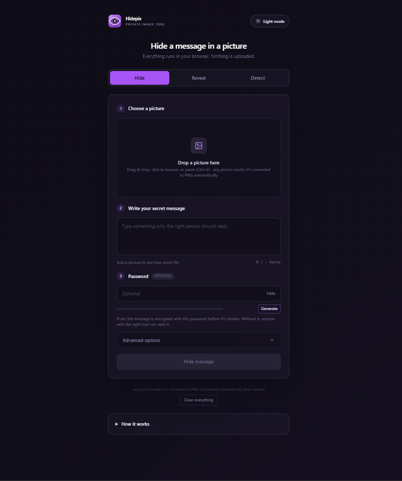
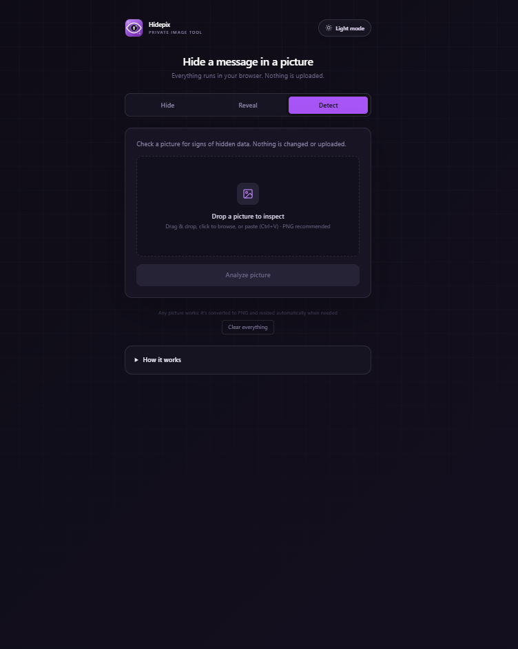

# Hidepix

A small website that hides a text message inside a picture and reads it back out again. I built it to understand how steganography actually works, so the hiding, the encryption wiring and the detection are all written by hand instead of coming from a library.

Live site: hidepix.vercel.app


## Screenshots

### Hide Tab


### Detect Tab


### Reveal Tab


## What it does

You pick a picture and type a message, and Hidepix gives you a PNG that looks exactly the same but has the message inside. Send that PNG to someone, they drop it into the Reveal tab, and the message comes back out. If you set a password, the message is encrypted first, so the picture is useless without it.

There's also a Detect tab. It checks whether a picture has a Hidepix message in it, and runs a couple of basic tests that try to spot hidden data in general.

Everything runs in your browser. The picture and the message never leave your device.

## How the hiding works

Every pixel is three numbers (red, green and blue) between 0 and 255. The last bit of each number hardly matters. Flipping it changes the colour by 1 out of 255, and nobody can see that. So I write the message into those last bits, one bit per number.

Before that, the text is turned into bytes, compressed if you ticked that box, and encrypted if you set a password. Then a small 12 byte header goes in front of it with a marker, the settings, the message length and a checksum. That's how Reveal knows how much to read, and why it says "wrong password or edited picture" instead of printing nonsense.

In Advanced you can switch the method to LSB matching, which nudges a value by 1 instead of overwriting the bit and is harder to detect. You can also turn on scatter, which spreads the bits around the picture using the password as a seed. Scatter hides where the bits are, but it doesn't protect what they say. Only the password does that (AES-GCM, with the key made by PBKDF2-SHA-256 at 600,000 rounds).

## Things to know

- It only works with PNG. If a picture gets recompressed, which is what Instagram, Messenger and saving as a JPG all do, the message is gone. Send the PNG as a file, not as a photo.
- Any picture you choose is converted to PNG automatically, and shrunk if it's over 16 megapixels or would be bigger than 10 MB as a PNG.
- It's a learning project, not a way to hide from a serious analyst. The header starts with a fixed marker and plain LSB leaves statistical traces.
- The chi-square test in the Detect tab only catches pictures that are filled almost to the brim. A clean result doesn't prove much.
- The finished PNG gets a SHA-256 hash so the receiver can check the file wasn't changed. That only helps if you send the hash by a different route than the picture.
- If you forget the password, the message can't be recovered. Nothing is saved anywhere.
- DCT hiding (the kind that survives JPG) isn't done.

## Run it yourself

```
npm install
npm run dev
```

To run the tests (they need Node 22.12 or newer):

```
npm test
```

## Deploying

I host it on Vercel. If the project sits in a subfolder of your repo, set that folder as the Root Directory in the Vercel settings. `vercel.json` adds a few security headers, including a Content-Security-Policy that stops the page from making requests to other sites.

## Code layout

```
src/
  App.tsx             the main screen and tabs
  components/         Dropzone, DetectTab, CompareSlider, HashLine, HowItWorks
  utils/stego.ts      hiding, revealing, header, encryption
  utils/analyze.ts    hash, chi-square test, last-bit view, password helpers
  utils/image.ts      PNG conversion and automatic resizing
  utils/save.ts       saving and sharing on phones
tests/stego.test.ts
vercel.json
```

Built with React, TypeScript, Vite and Tailwind.

## Still to do

- Make it installable as an app so it works offline
- Hide small files, not only text
- JPG-safe hiding